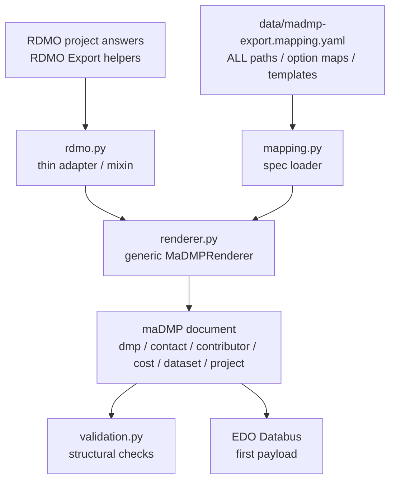

# socket-rdmo / madmp-exporter

Mapping-driven **maDMP export plugin for RDMO** — the in-RDMO variant of the
EDO/Regimo maDMP production. Renders an RDMO project (including snapshots) as
a machine-actionable DMP (maDMP, RDA common standard shape) directly from the
answers, next to the offline pipeline in
`projecting_spaces/EDO/Artefacts/07_Fragments/scripts/dmp/`.

**Card:** CF1-004 (DMP Erstellung mit RDMO) · **Fragment:** 02_DMP_Erstellung

---

## Design

Following the EDO principle **"intelligence in YAML, generic driver"**, all
catalog intelligence lives in a declarative mapping spec; the code is a
generic driver with a deliberately thin RDMO coupling:



| Module | Responsibility | Depends on |
|---|---|---|
| `mapping.py` | Load + validate the mapping spec (bundled, env-var or explicit path) | PyYAML |
| `renderer.py` | Generic maDMP rendering against a *value provider* | — (nothing!) |
| `validation.py` | Structural conformance checks (`{"dmp": {...}}` shape) | — |
| `rdmo.py` | Adapter: binds the renderer to `rdmo.projects.exports.Export` | RDMO/Django (lazy) |

The **value-provider contract** mirrors the RDMO `Export` base class helpers
(RDMO 2.5.x): `get_text`, `get_list`, `get_bool`, `get_timestamp`, `get_value`,
`get_option`, `get_set`. `tests/fakes.py::FakeExport` implements the same
contract as a mock, so the rendering logic is fully testable without RDMO.

> **RDMO pitfall (documented in the mixin):** pass `set_index` to the Export
> helpers **as a keyword** — the second positional slot is `set_prefix`.

## Layout

```
madmp-exporter/
├── pyproject.toml
├── README.md
├── src/rdmo_madmp_exporter/
│   ├── __init__.py            # public API: load_mapping, MaDMPRenderer, structural_checks
│   ├── mapping.py             # spec loading/validation (MappingError)
│   ├── renderer.py            # generic renderer (RDMO/Django-free)
│   ├── validation.py          # structural_checks(), summarize_checks()
│   ├── rdmo.py                # adapter: MaDMPExport (lazy RDMO binding)
│   └── data/
│       └── madmp-export.mapping.yaml   # bundled mapping spec (canonical copy)
└── tests/
    ├── conftest.py            # src on sys.path, RDMO_APP location
    ├── fakes.py               # RDMO Export mock (value-provider contract)
    ├── data/
    │   ├── bnetza-measurement-02-answers.json  # REAL answers of project #4
    │   └── alt-mapping.yaml                     # loader-test fixture
    ├── test_mapping.py        # loader tests
    ├── test_renderer.py       # mock tests (real answers, fake provider)
    ├── test_validation.py     # structural checks
    ├── test_rdmo_adapter.py   # adapter wiring without RDMO
    └── test_live_rdmo.py      # live tests (marker `live`, auto-skipped)
```

## Tests

Two tiers, with **identical expectations** — the mock tier proves the logic,
the live tier proves the instance:

| Tier | Environment | Command |
|---|---|---|
| Mock (no RDMO) | any Python ≥ 3.10 with `pip install -e .[test]` | `.venv/bin/python -m pytest tests -m "not live"` |
| Live (real RDMO) | the RDMO env (`pytest` required) | `/Users/ot2661/Servers/rdmo-app/env/bin/python -m pytest tests` |

The mock tests run against `tests/data/bnetza-measurement-02-answers.json` —
the ground-truth dump of the live RDMO project #4 (BNetzA BBPlG answer set),
produced by the traceable validation procedure
(`Artefacts/07_Fragments/scripts/dmp/04_P04_S04_validate-export.py`). Expected
values in mock and live tests therefore match by construction.

Live tests are auto-skipped when `tests/conftest.py::RDMO_APP` does not exist
(override via that constant; project id via `RDMO_PROJECT_ID`, default `4`).

## Installation & RDMO integration

The RDMO instance keeps a **one-line shim**; the package is installed into the
RDMO env (editable, so edits in this repo take effect after a server reload):

```bash
# 1. install the package into the RDMO env
/Users/ot2661/Servers/rdmo-app/env/bin/pip install --no-build-isolation \
    -e components/socket-rdmo/madmp-exporter

# 2. shim: site-packages/rdmo_madmp/exports.py
from rdmo_madmp_exporter.rdmo import MaDMPExport  # noqa: F401

# 3. registration (already in place): config/settings/local.py
PROJECT_EXPORTS += [('rdmo_madmp.exports.MaDMPExport')]
```

### Mapping-spec resolution order

1. explicit `MaDMPExport.mapping_file` (class attribute)
2. environment variable `EDO_MADMP_MAPPING`
3. the bundled `data/madmp-export.mapping.yaml`

Point 2/1 at another spec to bind the plugin to a different RDMO catalog —
no code changes required.

## API

```python
from rdmo_madmp_exporter import load_mapping, MaDMPRenderer, structural_checks

mapping = load_mapping()                      # bundled spec, validated
renderer = MaDMPRenderer(mapping, provider)   # provider = Export-like object
document = {"dmp": renderer.get_dmp()}
summary = structural_checks(document)         # list of {check, ok, detail}
```

Outside RDMO, compose the mixin with your own provider base:

```python
from rdmo_madmp_exporter.rdmo import MaDMPExportMixin
from fakes import FakeExport                  # your provider mock

class Export(MaDMPExportMixin, FakeExport): ...
export = Export(answers)                      # answers = ground-truth dump
```

## Provenance & traceability

| Artefact (seed) | Role here |
|---|---|
| `Artefacts/07_Fragments/scripts/dmp/exports.py` | original mapping-driven plugin, promoted into `renderer.py` + `rdmo.py` |
| `Artefacts/07_Fragments/scripts/dmp/03_P03_S03_madmp-export.mapping.yaml` | bundled as `data/madmp-export.mapping.yaml` (canonical copy lives here) |
| `Artefacts/07_Fragments/scripts/dmp/04_P04_S04_validate-export.py` | traceable validation; its structural checks are generalised in `validation.py` |
| `Artefacts/07_Fragments/scripts/dmp/measurement_02/Measurement_02-groundtruth.json` | canned as `tests/data/bnetza-measurement-02-answers.json` |

## Known limitations

* `dmp/contact` requires `project/data_management/{name,mbox}`; the
  preservation contributor's email lives at the **dataset level**
  (`project/dataset/preservation/responsible_person/email`) in the installed
  catalog — encoded in the bundled spec.
* `distribution.data_access` is only emitted when
  `project/dataset/sharing/yesno` is answered (option map
  `dataset_sharing_options/{67..70}`); the after-project distribution derives
  `closed` unless the during-project access is `open`.
* Costs are skipped unless the value is non-empty (empty costs are never
  rendered as `value: 0`).
* The plugin does not yet emit `ethical_issues_*`, `storage` budgets or
  metadata-standard IDs; extend the mapping spec as the catalog grows.
